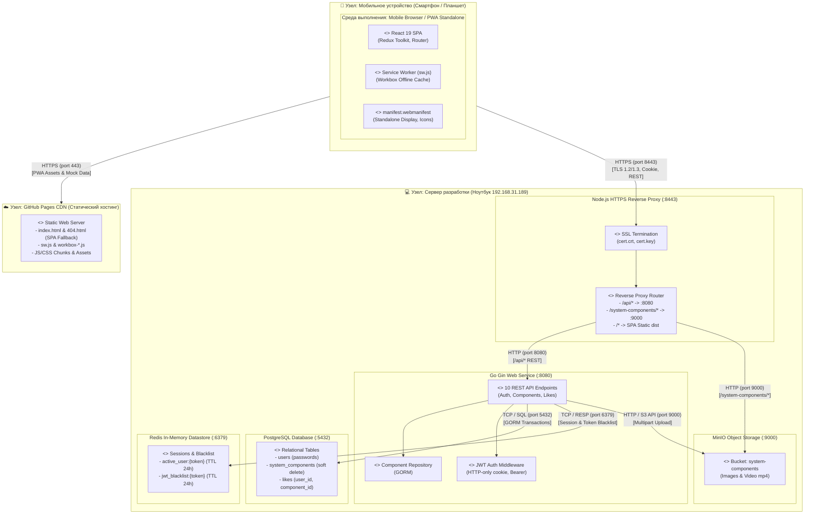

# Отчет по лабораторной работе №7
## «Внедрение адаптивности и развертывание приложения»

**Выполнил:** студент группы ИУ5-52Б Девятов И.  
**Тема предметной области:** Расчет времени отклика веб-приложения по задержкам архитектурных компонентов (шлюз, бэкенд, база данных, кэш, медиахранилище).

---

## 1. Ссылки на развертывание и репозитории
- **GitHub Pages (PWA в режиме Mock-данных):**  
  [https://ilyadevj.github.io/system-components-frontend/](https://ilyadevj.github.io/system-components-frontend/)
- **Репозиторий фронтенда:**  
  [https://github.com/Ilyadevj/system-components-frontend](https://github.com/Ilyadevj/system-components-frontend) (ветка `lab7`)
- **Репозиторий бэкенда:**  
  [https://github.com/Ilyadevj/system_components](https://github.com/Ilyadevj/system_components) (ветка `lab7`)
- **Локальный доступ со смартфона по HTTPS через реверс-прокси:**  
  `https://192.168.31.189:8443` (или локальный IP ноутбука в текущей Wi-Fi сети).

---

## 2. Порядок показа лабораторной работы (Скриншоты 1–17)

### Блок 1: GitHub Pages, Mock и Progressive Web App (Скриншоты 1–6)
- **Рисунок 1 – Открытие GitHub Pages со смартфона в режиме Mock-данных**  
  Открытие страницы `https://ilyadevj.github.io/system-components-frontend/` в мобильном браузере (Chrome / Safari). Сборка Pages использует локальную коллекцию `COMPONENTS_MOCK` в Redux Toolkit.
- **Рисунок 2 – Сохранение PWA на домашний экран смартфона**  
  Вызов системного меню браузера «Добавить на главный экран» / «Установить приложение». Браузер распознает Web App Manifest (`manifest.webmanifest`) и зарегистрированный Service Worker (`sw.js`).
- **Рисунок 3 – Запуск автономного приложения PWA**  
  Запуск PWA по ярлыку на рабочем столе смартфона: приложение открывается в режиме `display: standalone` без элементов управления и адресной строки браузера.
- **Рисунок 4 – Применение фильтрации компонентов в PWA**  
  Выбор чекбоксов слоев архитектуры (например, «Шлюзы», «Базы данных») в каталоге компонентов и нажатие кнопки «Применить».
- **Рисунок 5 – Переход на страницу детального просмотра («Подробнее»)**  
  Клик по карточке компонента: переход на страницу детальной видео-ленты (`/feed/:id`) с демонстрацией параметров («Группа», «Приоритет», время отклика, лайки).
- **Рисунок 6 – Возврат назад с сохранением состояния фильтра**  
  Возврат по кнопке «Назад» или через нижний TabBar («Плитка»): фильтры не сбросились, отображаются именно выбранные чекбоксы и отфильтрованный список карточек благодаря сохранению состояния в Redux Store.

### Блок 2: Адаптивность в браузере (Скриншот 7)
- **Рисунок 7 – Адаптивный режим браузера (DevTools Device Mode)**  
  Переход в режим адаптивного тестирования в браузере и демонстрация изменения ширины вьюпорта (320px -> 768px -> 1024px -> 1440px):
  - 4 колонки карточек на широком мониторе (> 1024px);
  - 3 колонки на ноутбуке (<= 1024px);
  - 2 колонки на планшете (<= 768px);
  - 1 колонка на мобильном телефоне (<= 460px) с карточками на 100% ширины экрана.

### Блок 3: Интеграция со смартфоном и реальным бэкендом (Скриншоты 8–12)
- **Рисунок 8 – Подключение телефона к ноутбуку по локальной сети**  
  Ноутбук и телефон подключены к одной Wi-Fi сети. Открытие в браузере смартфона адреса `https://192.168.31.189:8443` через Node.js HTTPS Reverse Proxy.
- **Рисунок 9 – Аутентификация пользователя на смартфоне**  
  Ввод логина и пароля на странице `/login`. Сервер Go валидирует пароль по данным в PostgreSQL, генерирует JWT-токен в HTTP-only cookie `jwt_token` и регистрирует активную сессию в Redis (`active_user:{user_id}`).
- **Рисунок 10 – Страница 1 на смартфоне: Каталог компонентов (бэкенд)**  
  Отображение каталога компонентов, полученных по REST API `GET /api/system-components` из базы данных PostgreSQL.
- **Рисунок 11 – Страница 2 на смартфоне: Детальная видео-лента (бэкенд)**  
  Воспроизведение видеопотока и графики из объектного хранилища MinIO (`/system-components/*`) и отправка лайка (`POST /api/system-components/:id/like`).
- **Рисунок 12 – Страница 3 на смартфоне: Форма создания и публикации (бэкенд)**  
  Создание черновика компонента и его публикация (`PUT /api/system-components/:id`) с передачей описания, группировки и приоритета на Go API.

### Блок 4: Настройка сертификатов и HTTPS (Скриншоты 13–14)
- **Рисунок 13 – Настройка локальных SSL-сертификатов**  
  Вывод скрипта `scripts/generate-cert.sh`: создание локального центра сертификации (`ca.crt`, `ca.key`) и сервера (`cert.crt`, `cert.key`) с расширением Subject Alternative Name (SAN: `DNS:localhost`, `IP:127.0.0.1`, `IP:192.168.31.189`).
- **Рисунок 14 – Использование HTTPS в браузере**  
  Защищенное соединение по протоколу HTTPS: индикатор безопасности, валидация сертификата, отсутствие предупреждений Mixed Content и активный Service Worker в DevTools -> Application.

### Блок 5: Разбор настроек адаптивности в исходном коде (Скриншоты 15–17)
- **Рисунок 15 – Настройки сетки и брейкпоинтов в коде CSS**  
  Фрагмент `src/MobileApp.css`: правила для `.cards-grid` с брейкпоинтами `@media (max-width: 1024px)`, `@media (max-width: 768px)`, `@media (max-width: 460px)` и конкретным числом колонок (4 -> 3 -> 2 -> 1).
- **Рисунок 16 – Размеры и геометрия карточек компонентов**  
  Фрагмент CSS: свойства `.grid-card`, отступы `gap` (20px, 16px, 14px, 12px), `padding` сетки и адаптивное соотношение сторон обложки `aspect-ratio: 16 / 10`.
- **Рисунок 17 – Адаптивная компоновка форм редактора и детального плеера**  
  Фрагмент CSS: двухколоночная сетка формы на экранах > 768px (`grid-template-columns: repeat(2, minmax(0, 1fr))`) и переход в одноколоночный стек на смартфонах.

---

## 3. UML Deployment диаграмма системы



### Таблица сетевых интерфейсов и протоколов
| Отправитель | Получатель | Протокол | Порт | Формат данных / Назначение |
|---|---|---|---|---|
| Смартфон | GitHub Pages | HTTPS (TLS 1.3) | 443 | Статические ассеты PWA, манифест, офлайн-кеш Service Worker |
| Смартфон | Node.js Proxy | HTTPS (TLS 1.2/1.3) | 8443 | Доступ в локальной сети: статика, REST API и стриминг медиа |
| Node.js Proxy | Go Gin Service | HTTP 1.1 | 8080 | Проксирование JSON REST API (`/api/users/*`, `/api/system-components/*`) |
| Node.js Proxy | MinIO S3 | HTTP 1.1 | 9000 | Проксирование изображений и видео (`/system-components/*`) |
| Go Service | PostgreSQL | TCP (PG protocol) | 5432 | Реляционные SQL-запросы через GORM (пользователи, компоненты) |
| Go Service | Redis | TCP (RESP) | 6379 | Сессии пользователей (`active_user`), черный список JWT (`jwt_blacklist`) |
| Go Service | MinIO S3 | HTTP (S3 REST) | 9000 | Multipart-загрузка медиафайлов и генерация постоянных URL |

---

## 4. Контрольные вопросы

### 4.1. Архитектура Flux
**Flux** — архитектурный паттерн, разработанный компанией Facebook для организации строго однонаправленного потока данных (Unidirectional Data Flow) в клиентских веб-приложениях. Главное преимущество перед классическим MVC — устранение циклических зависимостей между моделями и представлениями.

Поток данных Flux состоит из четырех звеньев:
1. **Action (Действие):** объект, инкапсулирующий тип события (`type`) и передаваемые данные (`payload`). Отражает намерение пользователя (нажатие кнопки) или ответ сервера.
2. **Dispatcher (Диспетчер):** центральный концентратор, через который проходят абсолютно все Actions. Работает как синглтон и синхронно распределяет действия всем зарегистрированным Store.
3. **Store (Хранилище):** содержит данные предметной области и логику их изменения. Получая Action от Dispatcher, Store обновляет внутреннее состояние и генерирует событие изменения (`change event`).
4. **View (Представление):** React-компоненты, подписанные на изменения Store. При получении уведомления компонент перерисовывается. При интерактивных действиях пользователя View создает новый Action и передает его Диспетчеру.

### 4.2. Схема Redux (Store, Reducer, Dispatch, Action)
Redux упрощает и формализует идеи Flux, опираясь на три правила:
1. **Единственный источник истины (Single source of truth):** всё глобальное состояние сосредоточено в едином дереве Store.
2. **Состояние только для чтения (State is read-only):** состояние иммутабельно, изменить его можно только отправкой Action.
3. **Изменения производятся чистыми функциями (Pure functions):** вычисление нового состояния возложено на Reducers.

Элементы схемы:
- **Action:** сериализуемый объект `{ type: string, payload?: any }`.
- **Dispatch:** метод `store.dispatch(action)`, инициирующий доставку действия.
- **Reducer:** чистая детерминированная функция `(state, action) => newState`, которая не имеет побочных эффектов (side-effects) и возвращает новый объект состояния.
- **Store:** центральный объект, хранящий дерево состояний, предоставляющий методы `getState()`, `dispatch()` и `subscribe()`.
- **Middleware & Thunk (`createAsyncThunk`):** промежуточное ПО для выполнения асинхронных операций (HTTP-запросы к бэкенду) до попадания результата в Reducer.

### 4.3. Виды нативных и гибридных приложений
1. **PWA (Progressive Web Application):**
   - *Технологии:* HTML, CSS, JavaScript, Web App Manifest, Service Worker.
   - *Плюсы:* Мгновенная установка в один клик без магазинов приложений (App Store / Google Play), кроссплатформенность, малый размер (сотни килобайт), работа офлайн через Service Worker, автообновления.
   - *Минусы:* Ограниченный доступ к низкоуровневому оборудованию (Bluetooth, NFC, USB, фоновые службы ОС).
2. **Tauri:**
   - *Технологии:* Фронтенд на React/Vue + ядро на языке Rust.
   - *Плюсы:* Использование системного веб-движка ОС (WebKit в macOS, WebView2 в Windows), размер дистрибутива всего 3–10 МБ, минимальное потребление оперативной памяти (в 5–10 раз меньше Electron), высокая безопасность и скорость Rust.
   - *Минусы:* Различия в рендеринге системных webview на старых версиях Windows/Linux.
3. **Electron:**
   - *Технологии:* Node.js + Chromium.
   - *Плюсы:* 100% идентичность рендеринга на всех ОС, полный доступ к Node.js API и файловой системе.
   - *Минусы:* Огромный размер дистрибутива (> 100 МБ), высокое потребление RAM и CPU.
4. **Cross-Platform Native (React Native, Flutter):**
   - *Технологии:* React Native (компиляция в нативные UIKit/Android Widgets) или Flutter (собственный графический движок Skia/Impeller на C++).
   - *Плюсы:* Честные 60/120 FPS, нативный UX платформы, неограниченный доступ к сенсорам и фоновым потокам.
   - *Минусы:* Требуется отдельная сборка APK/IPA, прохождение модерации в магазинах приложений.

### 4.4. Особенности и ограничения развертывания в GitHub Pages
1. **Статический хостинг:** GitHub Pages раздает только готовые статические файлы (HTML, JS, CSS, картинки). На нем невозможно запустить динамический бэкенд на Go, Python или базу данных.
2. **Базовый путь (`basename` / `base`):** Репозиторий развертывается по подпути `https://<user>.github.io/<repo-name>/`. В `vite.config.ts` (`base: '/system-components-frontend/'`) и `BrowserRouter` (`basename`) обязательно учитывать этот префикс, иначе ресурсы вернут 404.
3. **SPA-маршрутизация и 404 Fallback:** При переходе по ссылкам внутри SPA работает JavaScript-роутер. Но при обновлении страницы по прямому URL (например, `/feed/1`) сервер GitHub Pages ищет физический файл `feed/1/index.html` и возвращает 404. Для исправления в корень сборки копируется `404.html` (дубликат `index.html`).
4. **Mixed Content:** GitHub Pages работает исключительно по HTTPS. Браузер запрещает HTTP-запросы из HTTPS-контекста к внешним IP-адресам (Mixed Content Security Block). Поэтому на Pages используется автономный режим Mock-данных (`COMPONENTS_MOCK`).

---

## 5. Конкретные значения адаптивности в коде (для скриншотов 15–17)

Фрагмент из `src/MobileApp.css`:
```css
/* ==========================================================================
   НАСТРОЙКИ АДАПТИВНОСТИ ДЛЯ ЛАБОРАТОРНОЙ 7 (СКРИНШОТЫ 15-17)
   1. Десктоп (> 1024px):
      - Количество колонок: 4 (repeat(4, 1fr))
      - Внутренние отступы сетки (padding): 20px 24px
      - Межэлементный зазор (gap): 20px
      - Соотношение сторон обложки: aspect-ratio: 16 / 10
   2. Ноутбуки / Планшеты ландшафт (<= 1024px):
      - Количество колонок: 3 (repeat(3, 1fr))
      - Отступы (padding): 16px 20px
      - Межэлементный зазор (gap): 16px
   3. Планшеты портрет (<= 768px):
      - Количество колонок: 2 (repeat(2, 1fr))
      - Отступы (padding): 14px
      - Межэлементный зазор (gap): 14px
   4. Смартфоны / Мобильный режим (<= 460px):
      - Количество колонок: 1 (grid-template-columns: 1fr)
      - Карточка растягивается на 100% ширины
      - Отступы (padding): 12px
      - Межэлементный зазор (gap): 12px
   ========================================================================== */
.cards-grid {
  display: grid;
  grid-template-columns: repeat(4, 1fr);
  gap: 20px;
  padding: 20px 24px;
}

@media (max-width: 1024px) {
  .cards-grid {
    grid-template-columns: repeat(3, 1fr);
    gap: 16px;
    padding: 16px 20px;
  }
}

@media (max-width: 768px) {
  .cards-grid {
    grid-template-columns: repeat(2, 1fr);
    gap: 14px;
    padding: 14px;
  }
}

@media (max-width: 460px) {
  .cards-grid {
    grid-template-columns: 1fr;
    gap: 12px;
    padding: 12px;
  }
}
```
